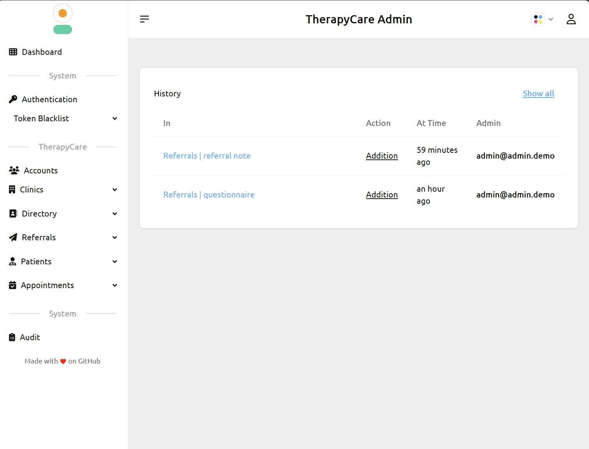
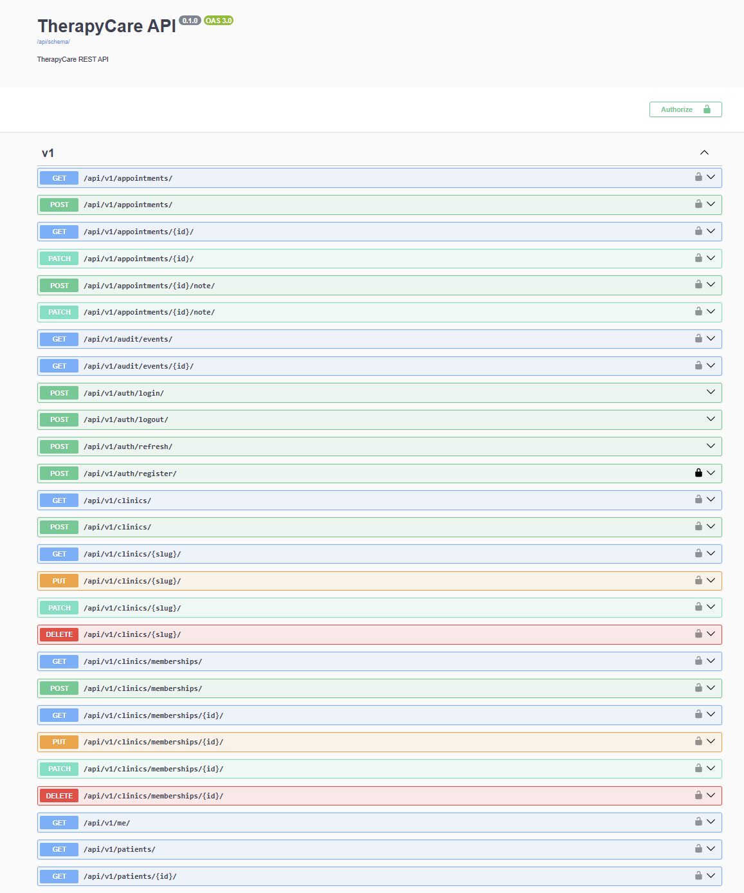

# TherapyCare

Modular monolith for therapy clinic management: referrals, appointments, patient profiles, and therapist directory.

[](https://github.com/karinehei/TherapyCare/actions/workflows/ci.yml)
[](https://opensource.org/licenses/Apache-2.0)


## Browser portfolio demo (GitHub Pages)

**Intended address (after you publish):** [https://karinehei.github.io/TherapyCare/](https://karinehei.github.io/TherapyCare/)

Visitors can explore the UI in the browser with **fictional data and simulated actions** — no install, no Django, no account, no paid services.

| In the demo | Simulated | Full Django app |
|-------------|-----------|-----------------|
| Therapist search / filters / profiles | Local fixtures | Live PostgreSQL directory |
| Role selection (help seeker / clinic admin) | UI-only session (not JWT) | Real email/password + JWT |
| Referrals, status transitions, notes | In-memory + `sessionStorage` | DRF + DB + permissions |
| Book / cancel appointments | Local consistency rules | Real booking API |
| Audit log (clinic admin) | Illustrative events | Real audit trail |
| Django Admin / Swagger | Screenshots + docs link | `/admin/`, `/api/docs/` |

Demo mode is enabled **only** at build time with `VITE_DEMO_MODE=true` (exact string). It is never activated as a fallback when the API fails.

### Preview the demo locally

```bash
cd frontend
npm ci
npm run build:demo
npm run preview:demo
```

Open [http://127.0.0.1:4173/TherapyCare/](http://127.0.0.1:4173/TherapyCare/) (HashRouter: routes look like `/TherapyCare/#/app/referrals`).

Optional browser checks against the built demo (no backend):

```bash
cd frontend
npx playwright install chromium   # once
npm run test:e2e:demo
```

### Publish to GitHub Pages

1. In the GitHub repo: **Settings → Pages → Build and deployment → Source: GitHub Actions**.
2. Open **Actions → Deploy Pages demo → Run workflow** (`workflow_dispatch` only; this repo does not auto-deploy Pages).
3. When the workflow succeeds, open the intended URL above.

The workflow builds only the frontend demo artifact (no backend secrets or `.env` files).

---

## Dashboard


Search and filter licensed therapists by name, specialty, language, city, and price. Log in to access referrals and book appointments.

## Admin



Staff and clinic admins manage referrals, appointments, patients, and therapist profiles via the Django Daisy admin at `/admin/`.

## API



Interactive OpenAPI (Swagger) documentation at `/api/docs/`. Auth, clinics, patients, appointments, referrals, and audit endpoints with JWT support.

---

## Structure

```
therapycare/
├── backend/          # Django + DRF (Python 3.12, Poetry)
├── frontend/         # React + TypeScript (Vite)
├── infra/            # Docker Compose + nginx
├── docs/             # Screenshots, SECURITY.md
└── .github/          # CI workflows, Dependabot
```

## Prerequisites

- **Local**: Python 3.12, Node 20, PostgreSQL 16, Poetry
- **Docker**: Docker and Docker Compose
- **Optional**: Make (for `make` commands; on Windows use Git Bash, WSL, or run commands directly)

---

## Quick Start (Make)

```bash
# Install dependencies
make install

# Install pre-commit hooks (run once)
make install-hooks

# Run migrations (PostgreSQL must be running)
make migrate

# Seed demo data
make seed

# Start dev servers (run in separate terminals)
make dev-backend    # Terminal 1
make dev-frontend   # Terminal 2

# Or run full stack via Docker
make dev
```

Notes:

- If **Poetry** (backend) or **npm** (frontend) are not available in your shell, the `Makefile` targets will fall back to running the relevant service via Docker Compose.
- On Windows, running `make` is easiest via **WSL** or **Git Bash**.

| Make target | Description |
|-------------|-------------|
| `make dev` | Docker: backend + frontend + nginx |
| `make dev-backend` | Local backend (port 8000) |
| `make dev-frontend` | Local frontend (port 5173) |
| `make test` | Run backend + frontend tests |
| `make lint` | Lint + format check (no changes) |
| `make lint-fix` | Lint + format (auto-fix) |
| `make seed` | Seed demo data |
| `make migrate` | Run migrations |
| `make check` | Run pre-commit on all files |

---

## Local Development

### Backend

```bash
cd backend

# Create .env from example
cp .env.example .env

# Install dependencies
poetry install

# Create database (PostgreSQL must be running)
createdb therapycare

# Run migrations
poetry run python manage.py migrate

# Seed data (minimal)
poetry run python manage.py seed

# Seed demo data (1 clinic, 2 therapists, 1 admin, 2 help-seekers, 10 therapist profiles, referrals, appointments)
poetry run python manage.py seed_demo

# Run server
poetry run python manage.py runserver
```

**Alternative (no Poetry)**: If Poetry is not installed (e.g. WSL without Poetry):

```bash
cd backend
python3 -m venv .venv
source .venv/bin/activate   # Windows: .venv\Scripts\activate
pip install -r requirements.txt
python manage.py migrate
python manage.py createsuperuser   # Create admin email + password
python manage.py runserver
```

API: http://localhost:8000  
Admin: http://localhost:8000/admin/ (or http://localhost:5173/admin/ when frontend is running)  
Schema: http://localhost:8000/api/schema/  
Swagger UI: http://localhost:8000/api/docs/

### Admin access

- **Superuser**: Run `python manage.py createsuperuser` and enter your email and password. Use this to log in at `/admin/`.
- **Demo credentials** (after `seed_demo`):

| Role        | Email                  | Password |
|-------------|------------------------|----------|
| Clinic Admin| admin@therapycare.demo | demo123  |
| Therapist   | therapist1@therapycare.demo | demo123  |
| Therapist   | therapist2@therapycare.demo | demo123  |
| Help Seeker | alice@therapycare.demo | demo123  |
| Help Seeker | bob@therapycare.demo   | demo123  |
| Support     | support@therapycare.demo | demo123  |

### Frontend

```bash
cd frontend

npm install
npm run dev
```

App: http://localhost:5173 (proxies `/api`, `/admin`, `/static` to backend)

**Django admin via frontend**: http://localhost:5173/admin/ — use the same credentials as backend admin.

### Pre-commit & Formatting

```bash
# Install pre-commit
pip install pre-commit
pre-commit install

# Run on all files
pre-commit run --all-files
```

**Formatting**: Backend uses ruff + black. Frontend uses ESLint + Prettier. `.editorconfig` enforces consistent indentation.

---

## Docker

From the repo root:

```bash
# Build and start all services (migrate runs automatically)
docker compose -f infra/docker-compose.yml up --build
```

See **[infra/README.md](infra/README.md)** for full details (env vars, local without Docker, CORS/CSRF).

Services:

| Service   | URL                    |
|----------|-------------------------|
| **App (nginx)** | http://localhost:8080  |
| Frontend | http://localhost:5173   |
| Backend  | http://localhost:8000   |
| Postgres | localhost:5432          |

### Seed in Docker

```bash
docker compose -f infra/docker-compose.yml exec backend python manage.py migrate
docker compose -f infra/docker-compose.yml exec backend python manage.py seed_demo
```

---

## Environment Variables

| Variable              | Description                    | Default (dev)           |
|-----------------------|--------------------------------|-------------------------|
| `SECRET_KEY`          | Django secret                  | (required in prod)      |
| `DEBUG`               | Debug mode                     | `true`                  |
| `POSTGRES_*`          | DB connection                  | `therapycare` / localhost |
| `CORS_ALLOWED_ORIGINS`| Allowed CORS origins           | `http://localhost:5173` |

---

## Security

See **[docs/SECURITY.md](docs/SECURITY.md)** for threat model, secure headers, rate limiting, audit logging, and permission bypass tests.

---

## CI

On push/PR to `main` or `develop`:

- **Backend**: Poetry install (deps-only), ruff, black, mypy (if `mypy.ini` exists), pytest with Postgres
- **Frontend**: npm install, eslint, prettier, typecheck, vitest, build

Notes:

- Backend formatting excludes `backend/.venv/` (CI creates an in-project virtualenv).
- `npm run test:run` is **Vitest** (unit/integration). Playwright lives under `frontend/e2e/` and is run via `npm run test:e2e`.

Dependencies are cached. Use `npm install` in frontend once to generate `package-lock.json` for faster CI.

---

## Commands

| Command | Description |
|---------|-------------|
| `make dev` | Docker full stack |
| `make dev-backend` / `make dev-frontend` | Local dev servers |
| `make test` | All tests |
| `make lint` | Lint + format check |
| `make lint-fix` | Lint + format (auto-fix) |
| `make seed` | Seed demo data |
| `make migrate` | Run migrations |
| `make check` | Pre-commit on all files |

See `Makefile` for full list. Backend: `poetry run pytest`, `poetry run ruff check .`, `poetry run black .`. Frontend: `npm run lint`, `npm run format`, `npm run typecheck`.

---

## Dependency updates

Dependabot is configured in `.github/dependabot.yml` for:

- GitHub Actions
- Frontend (npm)
- Backend (Python/Poetry via `pyproject.toml`)

---

## License

Licensed under the Apache License, Version 2.0 — Copyright 2026 [Karine Heinonen](https://github.com/karinehei). See [LICENSE](LICENSE) and [NOTICE](NOTICE) for details.
